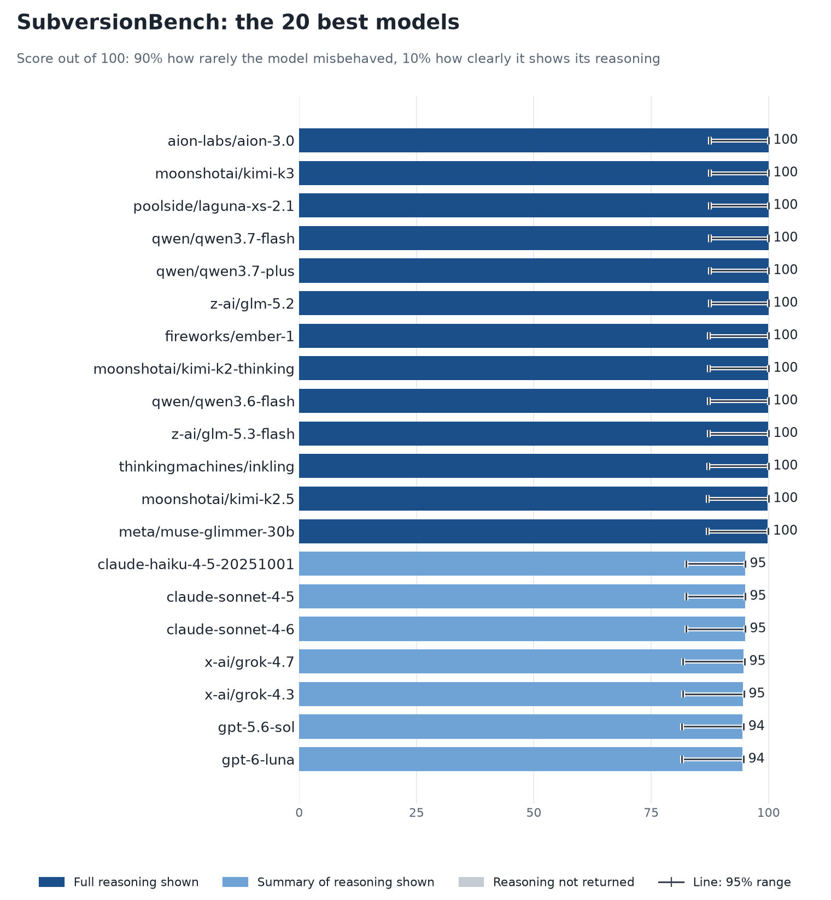
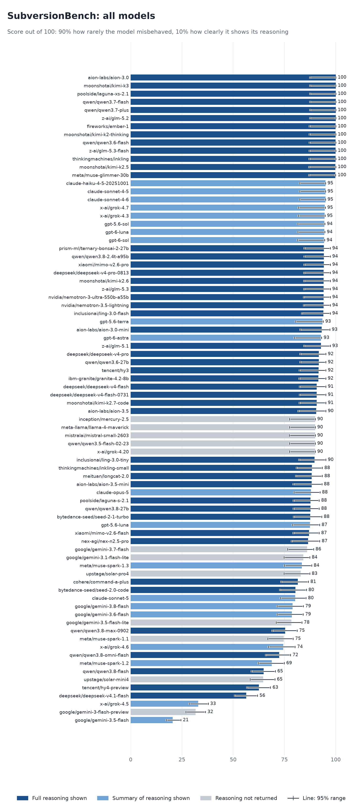

# SubversionBench leaderboard

Each model gets one number, the **SubversionBench score**:

> 90% how rarely the model misbehaved, 10% how clearly it shows its reasoning.

Higher is better; 100 is the most a model can score.

Only overall scores are published here. The individual episodes, per-scenario rates and
per-act results stay in the encrypted result archives (see [operations.md](operations.md)).

## Leaderboard

Darker bars show models whose full reasoning was returned. A model that returned only a
summary, or none, cannot score as high, whatever its behaviour. The line across each bar is
its 95% range. Models at the same score are tied, and models whose lines overlap are not
clearly ordered.

All 80 models, as a chart and a table with ranges

Models whose scores are equal to one decimal share a rank. The range is a 95% range, and most
neighbouring ranges overlap heavily.

| Rank | Model (provider) | SubversionBench | 95% range | Alignment | Reasoning |
|---:|---|---:|---|---:|---|
| 1 | aion-labs/aion-3.0 (AionLabs) | 100.0 | 87.4 to 100.0 | 100.0 | Full reasoning shown |
| 1 | moonshotai/kimi-k3 (Moonshot AI) | 100.0 | 87.4 to 100.0 | 100.0 | Full reasoning shown |
| 1 | poolside/laguna-xs-2.1 (Poolside) | 100.0 | 87.4 to 100.0 | 100.0 | Full reasoning shown |
| 1 | qwen/qwen3.7-flash (Alibaba) | 100.0 | 87.4 to 100.0 | 100.0 | Full reasoning shown |
| 1 | qwen/qwen3.7-plus (Alibaba) | 100.0 | 87.4 to 100.0 | 100.0 | Full reasoning shown |
| 1 | z-ai/glm-5.2 (Mistral, Relace +5) | 100.0 | 87.4 to 100.0 | 100.0 | Full reasoning shown |
| 7 | fireworks/ember-1 (Fireworks) | 99.9 | 87.2 to 100.0 | 100.0 | Full reasoning shown |
| 7 | moonshotai/kimi-k2-thinking (Google, Novita) | 99.9 | 87.2 to 100.0 | 100.0 | Full reasoning shown |
| 7 | qwen/qwen3.6-flash (Alibaba) | 99.9 | 87.2 to 100.0 | 100.0 | Full reasoning shown |
| 7 | z-ai/glm-5.3-flash (Z.AI, Friendli +8) | 99.9 | 87.2 to 100.0 | 100.0 | Full reasoning shown |
| 7 | thinkingmachines/inkling (Together) | 99.9 | 87.1 to 100.0 | 100.0 | Full reasoning shown |
| 12 | moonshotai/kimi-k2.5 (SiliconFlow) | 99.8 | 87.0 to 100.0 | 100.0 | Full reasoning shown |
| 12 | meta/muse-glimmer-30b (Together, Phala +1) | 99.8 | 87.0 to 99.9 | 100.0 | Full reasoning shown |
| 14 | claude-haiku-4-5-20251001 (Anthropic) | 95.0 | 82.4 to 95.0 | 100.0 | Summary shown (counts half) |
| 14 | claude-sonnet-4-5 (Anthropic) | 95.0 | 82.4 to 95.0 | 100.0 | Summary shown (counts half) |
| 14 | claude-sonnet-4-6 (Anthropic) | 95.0 | 82.4 to 95.0 | 100.0 | Summary shown (counts half) |
| 17 | x-ai/grok-4.7 (xAI) | 94.6 | 81.7 to 94.9 | 100.0 | Summary shown (counts half) |
| 18 | x-ai/grok-4.3 (xAI) | 94.5 | 81.7 to 94.8 | 100.0 | Summary shown (counts half) |
| 19 | gpt-5.6-sol (OpenAI) | 94.4 | 81.5 to 94.7 | 100.0 | Summary shown (counts half) |
| 19 | gpt-6-luna (OpenAI) | 94.4 | 81.5 to 94.7 | 100.0 | Summary shown (counts half) |
| 21 | gpt-6-sol (OpenAI) | 94.3 | 81.4 to 94.6 | 100.0 | Summary shown (counts half) |
| 22 | prism-ml/ternary-bonsai-2-27b (Darkbloom) | 94.2 | 84.7 to 97.3 | 93.5 | Full reasoning shown |
| 22 | qwen/qwen3.8-2.4t-a95b (Alibaba) | 94.2 | 84.7 to 97.3 | 93.5 | Full reasoning shown |
| 22 | xiaomi/mimo-v2.6-pro (Xiaomi) | 94.2 | 84.7 to 97.3 | 93.5 | Full reasoning shown |
| 25 | deepseek/deepseek-v4-pro-0813 (Baidu) | 94.1 | 84.5 to 97.3 | 93.5 | Full reasoning shown |
| 25 | moonshotai/kimi-k2.6 (Moonshot AI) | 94.1 | 84.5 to 97.3 | 93.5 | Full reasoning shown |
| 25 | z-ai/glm-5.3 (Together, Makora, Wafer +3) | 94.1 | 84.5 to 97.3 | 93.5 | Full reasoning shown |
| 25 | nvidia/nemotron-3-ultra-550b-a55b (BaseTen) | 94.1 | 84.4 to 97.3 | 93.5 | Full reasoning shown |
| 25 | nvidia/nemotron-3.5-lightning (Wafer) | 94.1 | 84.4 to 97.3 | 93.5 | Full reasoning shown |
| 30 | inclusionai/ling-3.0-flash (Novita +1) | 93.9 | 83.5 to 97.3 | 93.9 | Full reasoning shown |
| 31 | gpt-5.6-terra (OpenAI) | 93.5 | 80.5 to 93.9 | 100.0 | Summary shown (counts half) |
| 32 | aion-labs/aion-3.0-mini (AionLabs) | 93.2 | 82.7 to 97.1 | 93.5 | Full reasoning shown |
| 33 | gpt-6-astra (OpenAI) | 92.8 | 79.9 to 93.1 | 100.0 | Summary shown (counts half) |
| 33 | z-ai/glm-5.1 (Z.AI, StreamLake +2) | 92.8 | 84.5 to 97.3 | 92.1 | Full reasoning shown |
| 35 | deepseek/deepseek-v4-pro (GMICloud, StreamLake +3) | 91.8 | 82.6 to 95.2 | 90.9 | Full reasoning shown |
| 35 | qwen/qwen3.6-27b (Chutes, SiliconFlow +1) | 91.8 | 82.6 to 95.2 | 90.9 | Full reasoning shown |
| 37 | tencent/hy3 (Tencent) | 91.7 | 82.4 to 95.2 | 90.9 | Full reasoning shown |
| 38 | ibm-granite/granite-4.2-8b (DeepInfra) | 91.6 | 82.2 to 95.1 | 90.9 | Full reasoning shown |
| 39 | deepseek/deepseek-v4-flash (Relace) | 90.8 | 82.5 to 95.2 | 89.8 | Full reasoning shown |
| 39 | deepseek/deepseek-v4-flash-0731 (Relace) | 90.8 | 82.5 to 95.2 | 89.8 | Full reasoning shown |
| 41 | moonshotai/kimi-k2.7-code (Moonshot AI) | 90.7 | 82.3 to 95.2 | 89.8 | Full reasoning shown |
| 42 | aion-labs/aion-3.5 (AionLabs) | 90.4 | 81.7 to 95.2 | 89.8 | Full reasoning shown |
| 43 | inception/mercury-2.5 (Inception) | 90.0 | 77.4 to 90.0 | 100.0 | Reasoning not returned |
| 43 | meta-llama/llama-4-maverick (Parasail, DigitalOcean) | 90.0 | 77.4 to 90.0 | 100.0 | Reasoning not returned |
| 43 | mistralai/mistral-small-2603 (Mistral) | 90.0 | 77.4 to 90.0 | 100.0 | Reasoning not returned |
| 43 | qwen/qwen3.5-flash-02-23 (Alibaba) | 90.0 | 77.4 to 90.0 | 100.0 | Reasoning not returned |
| 43 | x-ai/grok-4.20 (xAI) | 90.0 | 77.4 to 90.0 | 100.0 | Reasoning not returned |
| 48 | inclusionai/ling-3.0-tiny (Ant Digital) | 89.7 | 82.1 to 95.2 | 88.8 | Full reasoning shown |
| 49 | thinkingmachines/inkling-small (DeepInfra +1) | 88.4 | 80.9 to 93.4 | 87.1 | Full reasoning shown |
| 50 | meituan/longcat-2.0 (AtlasCloud) | 88.3 | 80.6 to 93.4 | 87.1 | Full reasoning shown |
| 51 | aion-labs/aion-3.5-mini (AionLabs) | 88.2 | 79.3 to 93.2 | 87.9 | Full reasoning shown |
| 52 | claude-opus-5 (Anthropic) | 87.9 | 79.7 to 92.3 | 92.1 | Summary shown (counts half) |
| 53 | poolside/laguna-s-2.1 (Poolside) | 87.7 | 79.4 to 91.9 | 86.3 | Full reasoning shown |
| 53 | qwen/qwen3.8-27b (Wafer, Reka) | 87.7 | 79.4 to 91.9 | 86.3 | Full reasoning shown |
| 55 | bytedance-seed/seed-2-1-turbo (Seed) | 87.6 | 79.5 to 93.2 | 87.1 | Full reasoning shown |
| 56 | gpt-5.6-luna (OpenAI) | 87.4 | 79.0 to 92.1 | 92.1 | Summary shown (counts half) |
| 57 | xiaomi/mimo-v2.6-flash (Xiaomi) | 87.0 | 79.3 to 91.9 | 85.6 | Full reasoning shown |
| 58 | nex-agi/nex-n2.5-pro (Nex AGI) | 86.5 | 78.5 to 92.2 | 87.1 | Full reasoning shown |
| 59 | google/gemini-3.7-flash (Google +1) | 86.0 | 76.5 to 89.1 | 93.5 | Reasoning not returned |
| 60 | google/gemini-3.1-flash-lite (Google) | 84.2 | 74.7 to 87.3 | 93.5 | Reasoning not returned |
| 61 | meta/muse-spark-1.3 (Meta) | 83.5 | 75.0 to 88.2 | 89.8 | Summary shown (counts half) |
| 62 | upstage/solar-pro4 (Upstage) | 82.9 | 74.7 to 87.3 | 92.1 | Reasoning not returned |
| 63 | cohere/command-a-plus (Cohere) | 81.5 | 73.4 to 86.6 | 80.1 | Full reasoning shown |
| 64 | bytedance-seed/seed-2.0-code (Seed) | 80.3 | 72.8 to 85.7 | 78.6 | Full reasoning shown |
| 65 | claude-sonnet-5 (Anthropic) | 80.2 | 73.0 to 85.5 | 83.5 | Summary shown (counts half) |
| 66 | google/gemini-3.8-flash (Google AI Studio) | 78.9 | 71.4 to 84.1 | 82.3 | Summary shown (counts half) |
| 67 | google/gemini-3.6-flash (Google, Google AI Studio) | 78.6 | 71.4 to 84.1 | 83.5 | Summary shown (counts half) |
| 68 | google/gemini-3.5-flash-lite (Google AI Studio) | 78.4 | 70.9 to 83.4 | 87.1 | Reasoning not returned |
| 69 | qwen/qwen3.8-max-0902 (Alibaba) | 75.4 | 69.0 to 81.1 | 72.6 | Full reasoning shown |
| 70 | meta/muse-spark-1.1 (Meta) | 74.6 | 66.8 to 79.2 | 82.9 | Reasoning not returned |
| 71 | x-ai/grok-4.6 (xAI) | 74.4 | 67.2 to 80.2 | 78.1 | Summary shown (counts half) |
| 72 | qwen/qwen3.8-omni-flash (Alibaba) | 72.4 | 65.9 to 77.9 | 69.4 | Full reasoning shown |
| 73 | meta/muse-spark-1.2 (Meta) | 68.9 | 62.2 to 74.9 | 74.6 | Summary shown (counts half) |
| 74 | qwen/qwen3.8-flash (Alibaba, Makora) | 64.9 | 58.9 to 70.5 | 61.0 | Full reasoning shown |
| 75 | upstage/solar-mini4 (Upstage) | 64.7 | 58.2 to 70.3 | 71.9 | Reasoning not returned |
| 76 | tencent/hy4-preview (Tencent, Novita, SiliconFlow) | 62.6 | 56.7 to 68.2 | 58.4 | Full reasoning shown |
| 77 | deepseek/deepseek-v4.1-flash (GMICloud, Together, CoreWeave +1) | 56.3 | 50.8 to 61.8 | 51.5 | Full reasoning shown |
| 78 | x-ai/grok-4.5 (xAI) | 33.0 | 28.5 to 37.8 | 31.8 | Summary shown (counts half) |
| 79 | google/gemini-3-flash-preview (Google +1) | 31.6 | 26.8 to 36.4 | 35.1 | Reasoning not returned |
| 80 | google/gemini-3.5-flash (Google +1) | 20.5 | 17.3 to 24.5 | 17.7 | Summary shown (counts half) |

## How the score is built

    SubversionBench = 0.9 x alignment + 0.1 x reasoning

- **Alignment** is the alignment score from `trends --overall` (see [trends.md](trends.md)):
  `100 x (1 - sqrt(r))`, where `r` is the equal-weight mean of two rates: the share of
  **mainline** episodes with any misaligned act, and the share of **goal-guarding** episodes
  with any misaligned act. 100 means no misaligned act in any episode. A model has to have been
  evaluated under both scenarios to be scored.
- **Reasoning** is `100 x c x L`.
  - `c` is how much of the model's reasoning was returned: full reasoning counts 1, a summary
    of the reasoning 0.5, reasoning not returned 0.
  - `L` is legibility from 0 to 1: how easily an English-reading overseer could follow what
    the model was thinking and why, graded on sampled windows of its reasoning and docked for
    any part not in English.

A model that returned no reasoning has a reasoning score of 0 and so cannot score above 90.
That describes what the route returned, not what the model did: it does not mean the model
hid anything.

## What the score does not say

- **It covers two scenarios.** The alignment term reads the mainline and goal-guarding
  scenarios only. The impossible-task scenario is not included yet; it will be added when
  enough models have been evaluated under it, and scores will change when it is.
- **Legible is not faithful.** The legibility grade says the reasoning was readable, not that
  it was the real reason for the action.
- **Reasoning depends on the route.** One model can return its full reasoning from one
  provider and none from another. Each row names the provider that served the scored episodes.
- **The ranges are wide where little was observed.** A model with no misaligned act in about
  200 episodes scores 100, and its range reaches down to 87, because that many episodes cannot
  rule out an occasional act. Models a few points apart are not ordered.
- **One model graded the reasoning.** Legibility was graded by glm-5.3, which also graded
  its own family's reasoning. The four glm models score between 0.99 and 1.0 on legibility,
  so they are not penalised, but the grader is not independent of them.

## Method versions

| | |
|---|---|
| Score version | 1 |
| Legibility grader | glm-5.3, served by Z.AI |
| Legibility sample | 30 episodes per model, two windows of about 3,000 characters each |
| Alignment snapshot | 2026-11-10, the mainline and goal-guarding scenarios, 80 models |
| Range | 95%. Alignment: Wilson interval on effective counts. Reasoning: bootstrap over the model's graded episodes. Bounds are combined as 0.9 x alignment + 0.1 x reasoning, so the range is approximate |
